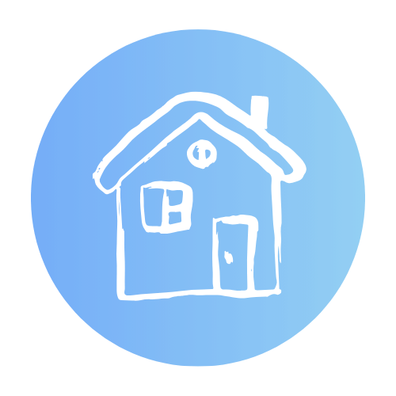
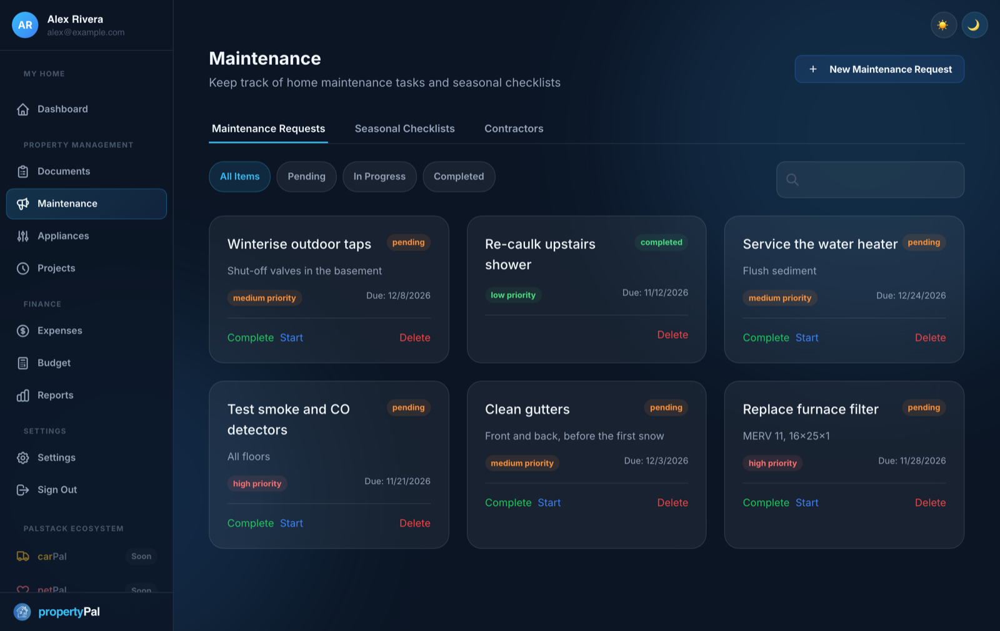
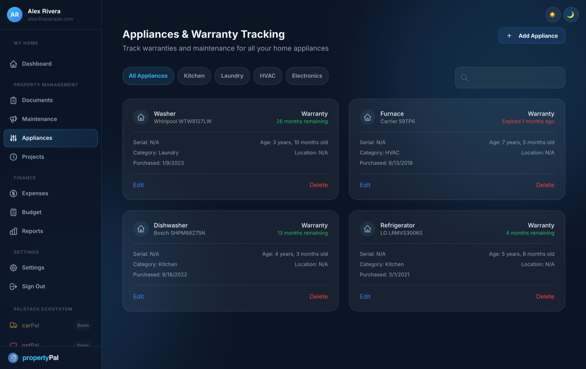

<div align="center">
  
  <h1>propertyPal</h1>
  <p><strong>Everything about your home, in one place you own.</strong></p>

  <p>
    <a href="#quick-start">Quick start</a> ·
    <a href="https://palstack.io/propertypal">Website</a> ·
    <a href="https://discord.gg/mcgcp7RdYs">Discord</a>
  </p>

  <p>
    <a href="LICENSE"></a>
    <a href="https://github.com/orgs/palStack-io/packages?repo_name=propertypal-core"></a>
    <a href="docs/HOME_ASSISTANT_INTEGRATION.md"></a>
  </p>
</div>

propertyPal is a self-hosted home manager. Keep the maintenance schedule, appliance warranties, documents, projects
and what the house costs you in one place, on your own server. Nothing is sent to us.

This repository is **propertyPal Core**: open source and free to self-host.

> [!NOTE]
> **Core is behind the hosted edition.** Hosted propertyPal has a newer design and features that have not been
> brought back to Core yet, so it looks different from what this repository runs. The screenshots below are Core as
> it runs from this repository today.

<p align="center">
  
  
</p>

## Features

- **Maintenance.** Requests with priority, due date and status, seasonal checklists, and a list of your contractors.
- **Appliances and warranties.** Make, model, serial, purchase date and how long the warranty has left.
- **Documents.** Upload and organise warranties, insurance, contracts and manuals.
- **Projects.** Home improvement projects with a budget, money spent and dates.
- **Expenses, budget and reports.** Log what the house costs by category, set a budget, and see where it went.
- **Photos** of the property, kept by date.
- **Home Assistant.** Read and update maintenance tasks with an API key; see
  [docs/HOME_ASSISTANT_INTEGRATION.md](docs/HOME_ASSISTANT_INTEGRATION.md).
- Light and dark themes; prebuilt images for `amd64` and `arm64`.

## Quick start

You need Docker with the Compose plugin and about 1 GB of RAM.

```bash
mkdir propertypal && cd propertypal
curl -fsSL -o docker-compose.yml https://raw.githubusercontent.com/palStack-io/propertypal-core/main/docker-compose.ghcr.yml
curl -fsSL -o .env https://raw.githubusercontent.com/palStack-io/propertypal-core/main/.env.example

# Generate your own secrets (propertyPal refuses to start with placeholders)
for key in SECRET_KEY JWT_SECRET_KEY POSTGRES_PASSWORD; do
  sed -i.bak "s|^$key=.*|$key=$(openssl rand -hex 32)|" .env
done && rm .env.bak

docker compose up -d
```

Open **http://localhost** and choose **Sign up**. The first account becomes the admin and owner of the home; after
that, sign-up is closed unless you set `ALLOW_REGISTRATION=true`. The setup wizard then asks for your property.

To serve on another port, set `PORT` in `.env`. Put propertyPal behind a reverse proxy with HTTPS (Caddy, nginx,
Traefik) before exposing it outside your network, and set `FRONTEND_URL` to that address so email links work.

**Upgrade:** `docker compose pull && docker compose up -d`.

**Try it with sample accounts:** set `DEMO_MODE=true` in `.env` to create three demo accounts
(`demo@propertypal.com`, password `Demo123!`). Only for trying it out: never on a server others can reach.

Other compose files: `docker-compose.yml` builds every service from this checkout (for development), and
`docker-compose.portainer.yml` is a single file for the Portainer stack editor.

## Configuration

| Variable | Default | What it does |
|---|---|---|
| `SECRET_KEY`, `JWT_SECRET_KEY` | none (required) | Sign sessions and tokens. 32+ random characters; placeholders are refused |
| `POSTGRES_PASSWORD` | none | Database password, fixed the first time Postgres starts |
| `PORT` | `80` | Port propertyPal is served on |
| `FRONTEND_URL` | `http://localhost` | Public address, used in email links |
| `ALLOW_REGISTRATION` | `false` | Let more people sign up after the first account |
| `SKIP_EMAIL_VERIFICATION` | `true` | Skip email verification (for installs without email) |
| `MAIL_SERVER`, `MAIL_PORT`, `MAIL_USE_TLS`, `MAIL_USERNAME`, `MAIL_PASSWORD`, `MAIL_DEFAULT_SENDER` | unset | SMTP for password-reset emails |
| `DEMO_MODE` | `false` | Create sample accounts on start |

## Architecture

```
nginx        reverse proxy, serves the web app
├── backend  Flask + SQLAlchemy: REST API, JWT auth, file uploads
├── frontend React + Tailwind CSS
└── db       PostgreSQL
```

The API is documented in [docs/API_INTEGRATION_GUIDE.md](docs/API_INTEGRATION_GUIDE.md).

## Core and hosted

| | Core (this repository) | Hosted |
|---|---|---|
| Maintenance, appliances, documents, projects, expenses, budget | Yes | Yes |
| Home Assistant and API keys | Yes | Yes |
| Newer design and features from the hosted roadmap | Being brought back | Yes |
| Phone app | No | In testing |
| Where your data lives | Your server | palStack's servers |

The [hosted demo](https://propertydemo.palstack.io) shows the hosted edition, not Core.

## Contributing

We have paused code contributions while we work out how to review AI-assisted changes well. Bug reports, ideas and
questions are very welcome: open an [issue](https://github.com/palStack-io/propertypal-core/issues) or join us on
[Discord](https://discord.gg/mcgcp7RdYs).

Found a security problem? Please report it privately; see [SECURITY.md](https://github.com/palStack-io/.github/blob/main/SECURITY.md).

## License

propertyPal Core is licensed under the [GNU Affero General Public License v3.0](LICENSE). You can use, change and
self-host it freely. If you run a modified version as a network service, you must publish your changes under the
same licence.

propertyPal is built for personal and household use. To run it commercially, or as a service without the AGPL's
obligations, contact **support@palstack.io** about a commercial licence.

---

<div align="center">
  <sub>Part of <a href="https://palstack.io">palStack.io</a>: everyday tools for food, money, home and friends.</sub>
</div>
